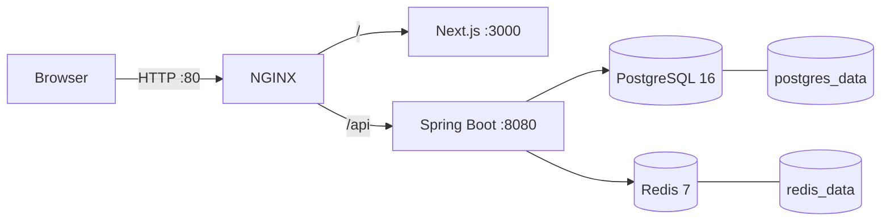
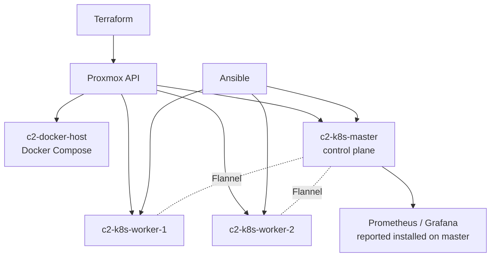

# DevOps Practical Exam - Infrastructure, Deployment & Monitoring

This repository contains Proxmox infrastructure-as-code, Ansible automation for a Kubernetes cluster, a Docker Compose application, and a command-line evidence collector.

> **Check the assignment scope before submission.** The supplied brief requests ProjectHub (React + Go/Gin + MongoDB + Valkey) and artifacts under `docker/`, `app/`, and `k8s/`. The checked-in application under `project-hub/` is MyDiary (Next.js + Spring Boot + PostgreSQL + Redis), and there are no checked-in Kubernetes application manifests. Existing reports show a `mydiary` namespace and Helm release, but reports are snapshots, not a reproducible deployment. This README describes the repository as it exists and does not claim the different brief requirements are complete.

## Contents

- [Architecture](#architecture)
- [Repository map](#repository-map)
- [1. Provision virtual machines](#1-provision-virtual-machines)
- [2. Configure Kubernetes with Ansible](#2-configure-kubernetes-with-ansible)
- [3. Run the application with Docker Compose](#3-run-the-application-with-docker-compose)
- [4. Kubernetes monitoring and evidence](#4-kubernetes-monitoring-and-evidence)
- [Prometheus and Grafana](#prometheus-and-grafana)
- [Security and known gaps](#security-and-known-gaps)

## Architecture

### Docker Compose application

NGINX publishes HTTP on port 80. It routes browser traffic to the Next.js frontend and `/api` requests to the Spring Boot API. The API uses PostgreSQL for persistent data and Redis as a cache. PostgreSQL and Redis are internal to the Compose network.



### Infrastructure and Kubernetes

Terraform provisions Proxmox VMs from a template. Ansible prepares the three Kubernetes nodes, installs containerd and Kubernetes components, initializes the control plane, installs Flannel, and joins the workers.



Kubernetes application manifests, a Helm chart, and Prometheus scrape/dashboard configuration are not checked in, so the reported Kubernetes runtime cannot be rebuilt from this repository alone.

## Repository map

| Path                                     | Purpose                                                                        |
| ---------------------------------------- | ------------------------------------------------------------------------------ |
| `iac/`                                 | Proxmox provider, VM resource, variables, outputs, and local state files.      |
| `ansible/`                             | Inventory, playbooks, shared variables, and roles for Kubernetes node setup.   |
| `monitoring/collect-k8s-monitoring.sh` | Timestamped Kubernetes, application, log, and host evidence collection.        |
| `monitoring/reports/`                  | Text output from a monitoring run. Inspect and sanitize before sharing.        |
| `project-hub/`                         | MyDiary source, Dockerfiles, Compose file, NGINX config, and deployment guide. |

## 1. Provision virtual machines

Terraform uses the `bpg/proxmox` provider (`~> 0.69`) and defaults to template ID `9002`, Proxmox node `Server1`, storage `local-lvm`, pool `exam-c2`, and network bridge `vmbr0`. `iac/main.tf` iterates over `vm_configs` to clone a VM per entry, configure CPU/memory/disk, set cloud-init account credentials, request a DHCP address, enable the guest agent, and start each VM. `iac/outputs.tf` exports VM names, IDs, and IPv4 addresses reported by the guest agent.

From the `iac/` directory:

```bash
cd iac
terraform init
terraform validate
terraform plan
terraform apply
terraform output vm_names
terraform output vm_ids
terraform output vm_ipv4_addresses
```

Terraform reads `terraform.tfvars` automatically. Supply the required Proxmox endpoint/token, VM login, and VM map through a private local tfvars file or `TF_VAR_...` environment variables. Do not commit real credentials. Protect Terraform state and backups: sensitive values can be stored there even when variables are marked `sensitive`.

## 2. Configure Kubernetes with Ansible

Ansible connects from the control machine as `devops` using `ansible/inventory.ini`:

| Alias               | Role          |  Inventory address |
| ------------------- | ------------- | -----------------: |
| `c2-k8s-master`   | Control plane | `192.168.160.76` |
| `c2-k8s-worker-1` | Worker        | `192.168.160.85` |
| `c2-k8s-worker-2` | Worker        | `192.168.160.84` |

These are configured inventory addresses; confirm current DHCP addresses against Terraform outputs before use.

### Playbook flow

1. `site.yml` applies the `common` and `containerd` roles to `kube_cluster`.
2. `roles/common` installs host utilities, enables chrony, disables swap, loads `overlay` and `br_netfilter`, and configures Kubernetes networking sysctls.
3. `roles/containerd` generates containerd configuration when needed, enables the CRI plugin, sets the systemd cgroup driver, and restarts the service through a handler.
4. `install-kubernetes.yml` prepares nodes and installs/enables `kubelet`, `kubeadm`, and `kubectl` from the configured RPM repository.
5. `initialize-master.yml` initializes the control plane, installs kubeconfig for `devops`, verifies the API, applies Flannel, and waits for its DaemonSet rollout.
6. `join-workers.yml` generates a join command on the master (hidden from Ansible output with `no_log`), checks whether each worker already joined, and joins workers that need it.

Run in order from `ansible/`, after confirming connectivity and privilege escalation:

```bash
cd ansible
ansible kube_cluster -m ping
ansible-playbook site.yml
ansible-playbook install-kubernetes.yml
ansible-playbook initialize-master.yml
ansible-playbook join-workers.yml
```

The master initialization must precede the worker join. The Ansible user needs sudo access. The tasks use `community.general.modprobe`; install that collection on the control machine if it is not present.

**Version consistency:** `group_vars/all.yml` declares Kubernetes `1.32`, the RPM role points to the `v1.37` repository, and the control-plane task pins `v1.37.2`. Reconcile these before a fresh build so the repository, packages, kubeadm, kubelet, and kubectl use one compatible version.

## 3. Run the application with Docker Compose

`project-hub/docker-compose.yml` defines five services:

| Service      | Image/build                  | Role                                            |
| ------------ | ---------------------------- | ----------------------------------------------- |
| `nginx`    | `nginx:1.28-alpine`        | Public entry point on port 80; reverse proxy.   |
| `frontend` | Multi-stage Node 22 build    | Next.js standalone app, internal port 3000.     |
| `backend`  | Multi-stage Temurin 21 build | Spring Boot API, internal port 8080.            |
| `postgres` | `postgres:16.6-bookworm`   | Database with named persistent volume.          |
| `redis`    | `redis:7.4-alpine`         | Password-protected cache with append-only data. |

Both application Dockerfiles separate build and runtime stages and run as an unprivileged user. Compose health checks gate dependent services. NGINX routes `/api` to Spring Boot and other paths to Next.js. Only NGINX publishes a host port; database and cache remain on the private Compose network.

On the Linux Docker host:

```bash
cd project-hub
cp .env.example .env
# Edit .env with unique strong JWT, PostgreSQL, and Redis secrets.
docker compose -f docker-compose.yml config
docker compose -f docker-compose.yml build
docker compose -f docker-compose.yml up -d
docker compose -f docker-compose.yml ps
```

Open `http://<docker-host-ip>/`. Check the proxy and API health endpoints and service logs:

```bash
curl -i http://<docker-host-ip>/healthz
curl -i http://<docker-host-ip>/api/health
docker compose -f docker-compose.yml logs -f nginx frontend backend postgres redis
```

The named volumes `postgres_data` and `redis_data` survive `docker compose down` and container recreation. `docker compose down -v` removes them. See [`project-hub/DEPLOYMENT.md`](project-hub/DEPLOYMENT.md) for detailed health checks, backup/restore, lifecycle, and Docker Hub guidance. The guide contains optional publishing instructions; this repository does not prove that images were pushed or which published tags were used.

## 4. Kubernetes monitoring and evidence

`monitoring/collect-k8s-monitoring.sh` is a snapshot collector, not a continuously running monitoring agent. Run it on the master or another machine with a valid `kubectl` context and permissions:

```bash
chmod +x monitoring/collect-k8s-monitoring.sh
./monitoring/collect-k8s-monitoring.sh
```

It writes to `monitoring/reports/<timestamp>/` and collects:

- cluster info, nodes, all-namespace pods/services/deployments/StatefulSets/DaemonSets;
- persistent volumes and claims, Kubernetes events, and `kubectl top` node/pod usage;
- `mydiary` namespace resources, pod descriptions, ConfigMaps, Secret metadata, Helm releases, and Helm values;
- timestamped logs from all containers in `mydiary` pods, plus node descriptions;
- disk, memory, uptime, and process output from the machine running the script.

The checked-in reports show a `mydiary` namespace and Helm release at collection time. They are point-in-time text evidence, not live monitoring, application screenshots, or deployment manifests. Host resource output covers only the machine where the collector ran. To evidence all four VMs, run host commands on each VM and capture screenshots with hostname visible. The collector continues after command failures, so review each report; `kubectl top` requires a working Metrics Server.

Useful live commands:

```bash
kubectl get nodes -o wide
kubectl get pods,svc,deploy,statefulset -A -o wide
kubectl get events -A --sort-by=.metadata.creationTimestamp
kubectl top nodes
kubectl top pods -A
kubectl logs -n mydiary <pod-name> --all-containers --timestamps
df -h
free -h
uptime
ps aux
ss -tulpn
```

## Prometheus and Grafana

Prometheus and Grafana are reported as installed directly on the Kubernetes master in addition to the script collector. Prometheus stores/scrapes time-series metrics; Grafana queries and visualizes them. The script gathers command output and application/container logs into files. Prometheus and Grafana alone do not provide centralized log storage.

No installation playbook, service definition, scrape configuration, dashboard provisioning, or screenshots for Prometheus/Grafana are in this repository. For repeatability, add the configuration used and document verified access URLs, scrape targets/exporters, data sources, and dashboards. Their default web ports are commonly 9090 and 3000, but verify actual service bindings and firewall rules on the master. Restrict access to monitoring interfaces.

## Security and known gaps

- Do not commit `.env` files, real Terraform variable files, Terraform state/backups, private keys, tokens, or Kubernetes Secret values. Store credentials in a private secret store or environment.
- The Terraform provider sets `insecure = true`, disabling Proxmox TLS certificate verification. Use a trusted certificate and enable verification when possible.
- The collector runs `helm get values ... -a` and captures workload details. Inspect reports for sensitive values and redact before sharing. Treat Kubernetes Secret objects and report files as sensitive.
- The Compose guide describes seeded exam accounts. Do not reuse demo credentials outside the isolated exercise; set `SEED_ENABLED=false` and rotate credentials for non-exam use.
- Compose serves HTTP on port 80. Terminate TLS appropriately before sending real credentials across an untrusted network.

### Brief coverage check

| Brief requirement                                                             | Current repository evidence                                                                                 |
| ----------------------------------------------------------------------------- | ----------------------------------------------------------------------------------------------------------- |
| Four VMs via Terraform and IP outputs                                         | VM resource and IP output exist. Confirm actual VM map and current IPs using Terraform outputs.             |
| ProjectHub React + Go + MongoDB + Valkey                                      | **Mismatch:** checked-in app is Next.js + Spring Boot + PostgreSQL + Redis.                           |
| Compose deployment and Docker Hub images                                      | Compose and Dockerfiles exist; live deployment and published image/tag names are not evidenced here.        |
| Ansible Kubernetes cluster                                                    | Playbooks and roles exist; reconcile Kubernetes version values.                                             |
| Same app on Kubernetes with probes, resources, secrets, persistence, NodePort | Reports show runtime resources, but application manifests/chart/config are absent from this repository.     |
| Persistence/cache-off behavior proof                                          | Not evidenced; current stack uses PostgreSQL and Redis, and no test transcript/screenshots are included.    |
| Monitoring all four VMs and containers with screenshots                       | Collector and Kubernetes text reports exist; per-VM screenshots and Docker/Redis usage evidence are absent. |
| Reproducible Grafana/Prometheus setup                                         | Reported installed on master; setup, scrape/dashboard configuration, and screenshots are absent.            |

Before representing this repository as satisfying the supplied brief, align the application stack and directory structure, add the Kubernetes deployment and monitoring configuration, and capture the required live evidence. Keep claims tied to checked-in files or clearly label them as observed state.
