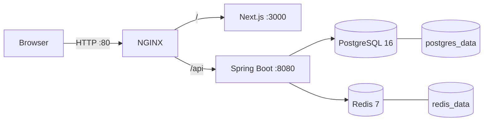
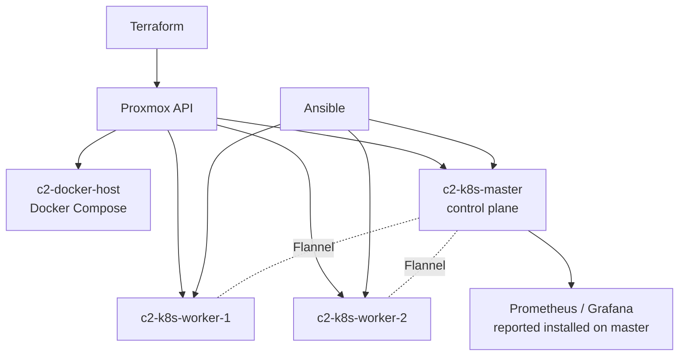

# DevOps Practical Exam - Infrastructure, Deployment & Monitoring

## Candidate and contact details

| Field | Details |
|---|---|
| Candidate number | Candidate-2 |
| Name | DUFITIMANA Theoneste |
| Email | [dufitimanatheoneste05@gmail.com](mailto:dufitimanatheoneste05@gmail.com) |
| Phone | 0796555276 |
| WhatsApp | 0786555276 |


This repository contains Proxmox infrastructure-as-code, Ansible automation for a Kubernetes cluster, a Docker Compose application, and a command-line evidence collector.

> **Check the assignment scope before submission.** The supplied brief requests ProjectHub (React + Go/Gin + MongoDB + Valkey) and artifacts under `docker/`, `app/`, and `k8s/`. The checked-in application under `project-hub/` is MyDiary (Next.js + Spring Boot + PostgreSQL + Redis), and there are no checked-in Kubernetes application manifests. The supplied master-node service output shows a `mydiary` namespace and Prometheus/Grafana services. The checked-in collector report, however, came from a shell without a working Kubernetes context and cannot verify that live state. This README describes the repository as it exists and does not claim the different brief requirements are complete.

## Contents

- [Architecture](#architecture)
- [Repository map](#repository-map)
- [1. Provision virtual machines](#1-provision-virtual-machines)
- [2. Configure Kubernetes with Ansible](#2-configure-kubernetes-with-ansible)
- [3. Run the application with Docker Compose](#3-run-the-application-with-docker-compose)
- [4. Kubernetes monitoring and evidence](#4-kubernetes-monitoring-and-evidence)
- [Prometheus and Grafana](#prometheus-and-grafana)
- [Security and known gaps](#security-and-known-gaps)

## Architecture

### Docker Compose application

NGINX publishes HTTP on port 80. It routes browser traffic to the Next.js frontend and `/api` requests to the Spring Boot API. The API uses PostgreSQL for persistent data and Redis as a cache. PostgreSQL and Redis are internal to the Compose network.



### Infrastructure and Kubernetes

Terraform provisions Proxmox VMs from a template. Ansible prepares the three Kubernetes nodes, installs containerd and Kubernetes components, initializes the control plane, installs Flannel, and joins the workers.



Kubernetes application manifests, a Helm chart, and Prometheus scrape/dashboard configuration are not checked in, so the reported Kubernetes runtime cannot be rebuilt from this repository alone.

## Repository map

| Path                                     | Purpose                                                                        |
| ---------------------------------------- | ------------------------------------------------------------------------------ |
| `iac/`                                 | Proxmox provider, VM resource, variables, outputs, and local state files.      |
| `ansible/`                             | Inventory, playbooks, shared variables, and roles for Kubernetes node setup.   |
| `monitoring/collect-k8s-monitoring.sh` | Timestamped Kubernetes, application, log, and host evidence collection.        |
| `monitoring/reports/`                  | Text output from a monitoring run. Inspect and sanitize before sharing.        |
| `project-hub/`                         | MyDiary source, Dockerfiles, Compose file, NGINX config, and deployment guide. |

## Task 1 - Provision four virtual machines with Terraform

Terraform uses the `bpg/proxmox` provider (`~> 0.69`) and clones template ID `9002` on Proxmox node `Server1`, into pool `exam-c2` and storage `local-lvm`, connected to bridge `vmbr0`. The VM definitions in `iac/terraform.tfvars` set four VMs to 4 vCPU, 4096 MB RAM, and a 30 GB disk each. `main.tf` uses `for_each = var.vm_configs`, so one resource block creates each VM from the map. Cloud-init sets the configured login and DHCP networking. The Proxmox guest agent is enabled; Terraform's IP output reads addresses reported by that agent.

The saved Terraform outputs identify the Task 1 VMs as follows. These are the addresses observed in the current Terraform state; because the guests use DHCP, check `terraform output vm_ipv4_addresses` again after a rebuild or lease change. Proxmox also reports `127.0.0.1` as a loopback address; the table shows the usable LAN address.

| VM | VM ID | Task role | vCPU | RAM | Disk | LAN IPv4 |
|---|---:|---|---:|---:|---:|---|
| `c2-docker-host` | 201 | Docker Compose application host | 4 | 4 GB | 30 GB | `192.168.160.48` |
| `c2-k8s-master` | 202 | Kubernetes control plane | 4 | 4 GB | 30 GB | `192.168.160.76` |
| `c2-k8s-worker-1` | 203 | Kubernetes worker | 4 | 4 GB | 30 GB | `192.168.160.85` |
| `c2-k8s-worker-2` | 204 | Kubernetes worker | 4 | 4 GB | 30 GB | `192.168.160.84` |

### How Task 1 was created

1. The Proxmox provider in `provider.tf` connects to the API using input variables. The token secret and VM account password are marked sensitive and supplied outside the README.
2. `variables.tf` defines the API, template, node, storage, pool, bridge, login, and VM map inputs. The map gives each VM its VM ID, CPU count, memory in MB, and disk size in GB.
3. `main.tf` loops over the map, clones the template, attaches CPU, memory, disk, and virtual NIC configuration, supplies cloud-init account/network settings, enables the guest agent, and starts each VM.
4. `outputs.tf` exposes VM names, IDs, and guest-agent IPv4 addresses so the addresses can be reused in the Ansible inventory.

From the `iac/` directory:


```bash
cd iac
terraform init
terraform validate
terraform plan
terraform apply
terraform output vm_names
terraform output vm_ids
terraform output vm_ipv4_addresses
```

Terraform reads `terraform.tfvars` automatically. Supply the required Proxmox endpoint/token, VM login, and VM map through a private local tfvars file or `TF_VAR_...` environment variables. Do not commit real credentials. Protect Terraform state and backups: sensitive values can be stored there even when variables are marked `sensitive`.

## 2. Configure Kubernetes with Ansible

Ansible connects from the control machine as `devops` using `ansible/inventory.ini`:

| Alias               | Role          |  Inventory address |
| ------------------- | ------------- | -----------------: |
| `c2-k8s-master`   | Control plane | `192.168.160.76` |
| `c2-k8s-worker-1` | Worker        | `192.168.160.85` |
| `c2-k8s-worker-2` | Worker        | `192.168.160.84` |

These are configured inventory addresses; confirm current DHCP addresses against Terraform outputs before use.

### Playbook flow

1. `site.yml` applies the `common` and `containerd` roles to `kube_cluster`.
2. `roles/common` installs host utilities, enables chrony, disables swap, loads `overlay` and `br_netfilter`, and configures Kubernetes networking sysctls.
3. `roles/containerd` generates containerd configuration when needed, enables the CRI plugin, sets the systemd cgroup driver, and restarts the service through a handler.
4. `install-kubernetes.yml` prepares nodes and installs/enables `kubelet`, `kubeadm`, and `kubectl` from the configured RPM repository.
5. `initialize-master.yml` initializes the control plane, installs kubeconfig for `devops`, verifies the API, applies Flannel, and waits for its DaemonSet rollout.
6. `join-workers.yml` generates a join command on the master (hidden from Ansible output with `no_log`), checks whether each worker already joined, and joins workers that need it.

Run in order from `ansible/`, after confirming connectivity and privilege escalation:

```bash
cd ansible
ansible kube_cluster -m ping
ansible-playbook site.yml
ansible-playbook install-kubernetes.yml
ansible-playbook initialize-master.yml
ansible-playbook join-workers.yml
```

The master initialization must precede the worker join. The Ansible user needs sudo access. The tasks use `community.general.modprobe`; install that collection on the control machine if it is not present.

**Version consistency:** `group_vars/all.yml` declares Kubernetes `1.32`, the RPM role points to the `v1.37` repository, and the control-plane task pins `v1.37.2`. Reconcile these before a fresh build so the repository, packages, kubeadm, kubelet, and kubectl use one compatible version.

## 3. Run the application with Docker Compose

`project-hub/docker-compose.yml` defines five services:

| Service      | Image/build                  | Role                                            |
| ------------ | ---------------------------- | ----------------------------------------------- |
| `nginx`    | `nginx:1.28-alpine`        | Public entry point on port 80; reverse proxy.   |
| `frontend` | Multi-stage Node 22 build    | Next.js standalone app, internal port 3000.     |
| `backend`  | Multi-stage Temurin 21 build | Spring Boot API, internal port 8080.            |
| `postgres` | `postgres:16.6-bookworm`   | Database with named persistent volume.          |
| `redis`    | `redis:7.4-alpine`         | Password-protected cache with append-only data. |

### How the multi-stage Dockerfiles work

The application images are built from the source in `project-hub/`; Compose builds them with `./frontend` and `./backend` contexts. Each Dockerfile keeps build tooling and intermediate dependencies in builder stages, then copies only runtime artifacts into a fresh runtime image.

- **Frontend (`frontend/Dockerfile`):** the `dependencies` stage installs the locked npm dependency tree using `npm ci`. The `build` stage runs the Next.js production build with standalone output enabled. The `runtime` stage uses Node 22 Alpine, copies the standalone server, static assets, and public files, and runs `node server.js` as an unprivileged UID 10001 user on port 3000.
- **Backend (`backend/Dockerfile`):** the `build` stage uses Eclipse Temurin JDK 21 and the Maven wrapper to resolve dependencies and package the Spring Boot application. The `runtime` stage uses the smaller Temurin JRE 21 image, copies only `diary-api.jar`, and runs Java as an unprivileged UID 10001 user on port 8080. The container has memory-aware JVM options and exits if it encounters an out-of-memory condition.
- **Proxy and data services:** NGINX uses the official NGINX image and mounts `nginx/nginx.conf` read-only. PostgreSQL and Redis use official images with named data volumes. Compose health checks control startup dependencies; only NGINX publishes host port 80.

This reduces the runtime image contents and keeps compilers/package build tools out of the running application containers. The exact service topology is shown above; the detailed lifecycle commands are in `project-hub/DEPLOYMENT.md`.

On the Linux Docker host:

```bash
cd project-hub
cp .env.example .env
# Edit .env with unique strong JWT, PostgreSQL, and Redis secrets.
docker compose -f docker-compose.yml config
docker compose -f docker-compose.yml build
docker compose -f docker-compose.yml up -d
docker compose -f docker-compose.yml ps
```

Open `http://<docker-host-ip>/`. Check the proxy and API health endpoints and service logs:

```bash
curl -i http://<docker-host-ip>/healthz
curl -i http://<docker-host-ip>/api/health
docker compose -f docker-compose.yml logs -f nginx frontend backend postgres redis
```

The named volumes `postgres_data` and `redis_data` survive `docker compose down` and container recreation. `docker compose down -v` removes them. See [`project-hub/DEPLOYMENT.md`](project-hub/DEPLOYMENT.md) for detailed health checks, backup/restore, lifecycle, and Docker Hub guidance. The guide contains optional publishing instructions; this repository does not prove that images were pushed or which published tags were used.

## Kubernetes deployment, app demonstration, and observability

The following runbook reflects the service names and ports shown in the `kubectl get svc` output supplied from `c2-k8s-master`. The Kubernetes services are internal ClusterIP services except for the NGINX NodePort. The output showed `nginx` exposed as port `30080` in namespace `mydiary`, making the app reachable at `http://192.168.160.76:30080` while that node IP and NodePort remain current.

### 1. Confirm the cluster and Helm release on the master

Run these commands on `c2-k8s-master` using the admin kubeconfig:

```bash
kubectl config current-context
kubectl get nodes -o wide
helm list -A
helm status mydiary -n mydiary
```

The available checked-in files do not include the Helm chart or its values file, so they do not establish the exact chart source or install arguments used for the existing release. To record the install reproducibly, retain the chart reference and values file and use the same source, for example:

```bash
helm upgrade --install mydiary ./<chart-directory> \
  --namespace mydiary --create-namespace \
  --values ./<chart-directory>/values.yaml
```

Replace the chart directory and values file with the actual chart used. After deployment, confirm rollout and record the images:

```bash
kubectl get pods -n mydiary -o wide
kubectl get deployments -n mydiary
kubectl rollout status deployment/<deployment-name> -n mydiary
kubectl get pods -n mydiary \
  -o custom-columns='NAME:.metadata.name,IMAGES:.spec.containers[*].image,NODE:.spec.nodeName'
helm get values mydiary -n mydiary
helm get manifest mydiary -n mydiary
```

These commands show which image repositories/tags are running, where pods were scheduled, and the values/manifests rendered by Helm. Do not include Secret values in captured output. The exact MyDiary image names and tags were not available in the repository evidence inspected for this README, so read them from the live pods rather than guessing.

### 2. Check services and open the application

First inspect the application services and NodePort:

```bash
kubectl get svc -n mydiary
```

The supplied output showed `frontend` on ClusterIP port 3000, `backend` on ClusterIP port 8080, `postgres` on 5432, `redis` on 6379, and `nginx` on `80:30080/TCP`. The browser URL from the master is:

```text
http://192.168.160.76:30080
```

If testing locally on the master through the requested `127.0.0.1:18080` address, start a port-forward in one terminal and leave it running:

```bash
kubectl port-forward -n mydiary svc/nginx 18080:80
```

Then open `http://127.0.0.1:18080` in a browser on that machine, or check the API from another terminal. This demonstrates routing through the NGINX service to the app.

### 3. Demonstrate registration and API functionality

Use a fresh test identity and a unique password in your own terminal. The example deliberately uses placeholders so personal registration data and passwords are not stored in this README:

```bash
curl -i -X POST http://127.0.0.1:18080/api/auth/register \
  -H "Content-Type: application/json" \
  -d '{"fullName":"Test User","email":"<unique-test-email>","password":"<unique-test-password>"}'
```

A successful registration should return a success HTTP status and an application response. Then use the UI to sign in with that test account and exercise the available app features. Check API health separately:

```bash
curl -i http://127.0.0.1:18080/api/health
```

For an external client, replace `127.0.0.1:18080` with `192.168.160.76:30080`. Do not commit real account details, JWTs, or command output containing credentials.

### 4. Verify Prometheus targets and Grafana

The supplied master-node service output places the monitoring release in the `default` namespace. Confirm the current service names first:

```bash
kubectl get svc -n default
kubectl get pods -n default -o wide
```

The supplied output lists `prometheus-kube-prometheus-prometheus` on port 9090, `prometheus-grafana` on port 80, the Prometheus Operator, kube-state-metrics, node-exporter, and Alertmanager. Use port-forwarding to access the ClusterIP services locally on the master:

```bash
# Terminal 1: Prometheus UI/API
kubectl port-forward -n default svc/prometheus-kube-prometheus-prometheus 19090:9090

# Terminal 2: check Prometheus health and scrape targets
curl -fsS http://127.0.0.1:19090/-/healthy
curl -fsS http://127.0.0.1:19090/api/v1/targets | jq '.data.activeTargets[] | {job: .labels.job, health: .health, scrapeUrl: .scrapeUrl}'

# Terminal 3: Grafana UI
kubectl port-forward -n default svc/prometheus-grafana 13000:80
```

Open `http://127.0.0.1:13000` for Grafana. Retrieve the initial admin password from the Kubernetes Secret as follows; the command prints the password to the terminal, so do not include its output in screenshots, logs, or this repository:

```bash
kubectl get secret --namespace default \
  -l app.kubernetes.io/component=admin-secret \
  -o jsonpath="{.items[0].data.admin-password}" | base64 --decode
echo
```

Sign in with username `admin` and the retrieved password, then confirm that the Prometheus data source is configured and dashboards show data. Rotate the initial password after first sign-in if the deployment supports it. To stop a port-forward, press Ctrl-C in its terminal.

The commands above verify Prometheus health and whether scrape targets are up; a running Service alone does not prove metrics are being collected. The supplied Service listing is a point-in-time snapshot, so check actual targets and dashboard data on the live cluster.

## 4. Kubernetes monitoring and evidence

`monitoring/collect-k8s-monitoring.sh` is a snapshot collector, not a continuously running monitoring agent. Run it on the master or another machine with a valid `kubectl` context and permissions:

```bash
chmod +x monitoring/collect-k8s-monitoring.sh
./monitoring/collect-k8s-monitoring.sh
```

It writes to `monitoring/reports/<timestamp>/` and collects:

- cluster info, nodes, all-namespace pods/services/deployments/StatefulSets/DaemonSets;
- persistent volumes and claims, Kubernetes events, and `kubectl top` node/pod usage;
- `mydiary` namespace resources, pod descriptions, ConfigMaps, Secret metadata, Helm releases, and Helm values;
- timestamped logs from all containers in `mydiary` pods, plus node descriptions;
- disk, memory, uptime, and process output from the machine running the script.

The checked-in report files were generated when the collector could not connect to a Kubernetes API at `localhost:8080`, and Helm was unavailable in that shell. Treat those files as a failed collection attempt, not proof of cluster health. The service and NodePort details above come from the output supplied from the master. Replace the failed reports with a fresh run from a working master-node context. They are point-in-time text evidence, not live monitoring, application screenshots, or deployment manifests. Host resource output covers only the machine where the collector ran. To evidence all four VMs, run host commands on each VM and capture screenshots with hostname visible. The collector continues after command failures, so review each report; `kubectl top` requires a working Metrics Server.

Useful live commands:

```bash
kubectl get nodes -o wide
kubectl get pods,svc,deploy,statefulset -A -o wide
kubectl get events -A --sort-by=.metadata.creationTimestamp
kubectl top nodes
kubectl top pods -A
kubectl logs -n mydiary <pod-name> --all-containers --timestamps
df -h
free -h
uptime
ps aux
ss -tulpn
```

## Prometheus and Grafana

Prometheus and Grafana are reported as installed directly on the Kubernetes master in addition to the script collector. Prometheus stores/scrapes time-series metrics; Grafana queries and visualizes them. The script gathers command output and application/container logs into files. Prometheus and Grafana alone do not provide centralized log storage.

No installation playbook, service definition, scrape configuration, dashboard provisioning, or screenshots for Prometheus/Grafana are in this repository. For repeatability, add the configuration used and document verified access URLs, scrape targets/exporters, data sources, and dashboards. Their default web ports are commonly 9090 and 3000, but verify actual service bindings and firewall rules on the master. Restrict access to monitoring interfaces.

## Security and known gaps

- Do not commit `.env` files, real Terraform variable files, Terraform state/backups, private keys, tokens, or Kubernetes Secret values. Store credentials in a private secret store or environment.
- The Terraform provider sets `insecure = true`, disabling Proxmox TLS certificate verification. Use a trusted certificate and enable verification when possible.
- The collector runs `helm get values ... -a` and captures workload details. Inspect reports for sensitive values and redact before sharing. Treat Kubernetes Secret objects and report files as sensitive.
- The Compose guide describes seeded exam accounts. Do not reuse demo credentials outside the isolated exercise; set `SEED_ENABLED=false` and rotate credentials for non-exam use.
- Compose serves HTTP on port 80. Terminate TLS appropriately before sending real credentials across an untrusted network.

### Brief coverage check

| Brief requirement                                                             | Current repository evidence                                                                                 |
| ----------------------------------------------------------------------------- | ----------------------------------------------------------------------------------------------------------- |
| Four VMs via Terraform and IP outputs                                         | VM resource and IP output exist. Confirm actual VM map and current IPs using Terraform outputs.             |
| ProjectHub React + Go + MongoDB + Valkey                                      | **Mismatch:** checked-in app is Next.js + Spring Boot + PostgreSQL + Redis.                           |
| Compose deployment and Docker Hub images                                      | Compose and Dockerfiles exist; live deployment and published image/tag names are not evidenced here.        |
| Ansible Kubernetes cluster                                                    | Playbooks and roles exist; reconcile Kubernetes version values.                                             |
| Same app on Kubernetes with probes, resources, secrets, persistence, NodePort | The user-supplied master output lists the services; the checked-in collection failed to connect, and application manifests/chart/config are absent from this repository.     |
| Persistence/cache-off behavior proof                                          | Not evidenced; current stack uses PostgreSQL and Redis, and no test transcript/screenshots are included.    |
| Monitoring all four VMs and containers with screenshots                       | Collector and Kubernetes text reports exist; per-VM screenshots and Docker/Redis usage evidence are absent. |
| Reproducible Grafana/Prometheus setup                                         | Reported installed on master; setup, scrape/dashboard configuration, and screenshots are absent.            |

Before representing this repository as satisfying the supplied brief, align the application stack and directory structure, add the Kubernetes deployment and monitoring configuration, and capture the required live evidence. Keep claims tied to checked-in files or clearly label them as observed state.
